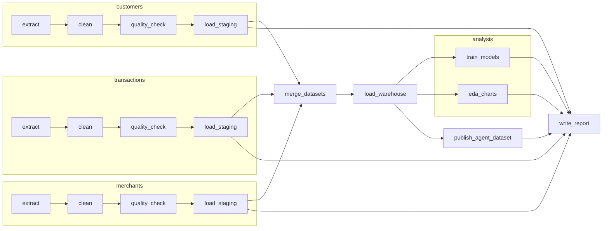
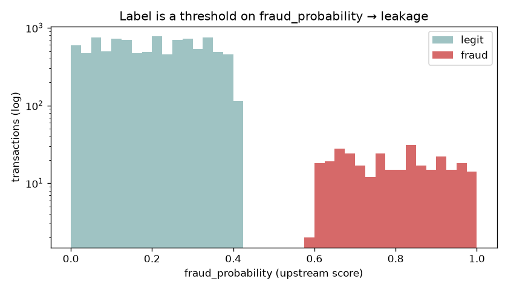
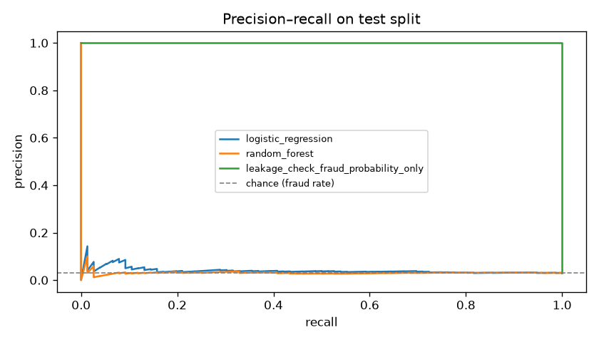
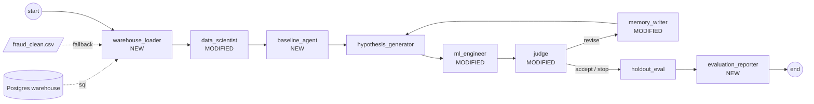
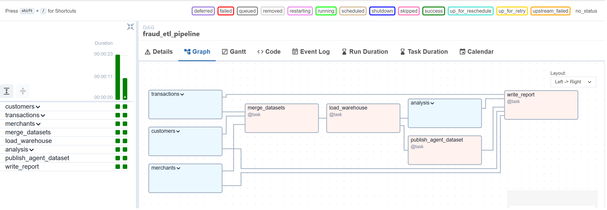
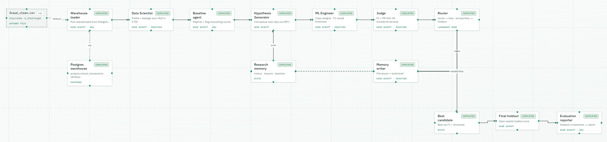
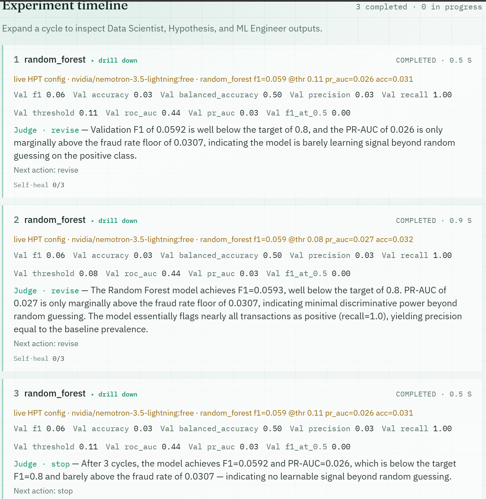
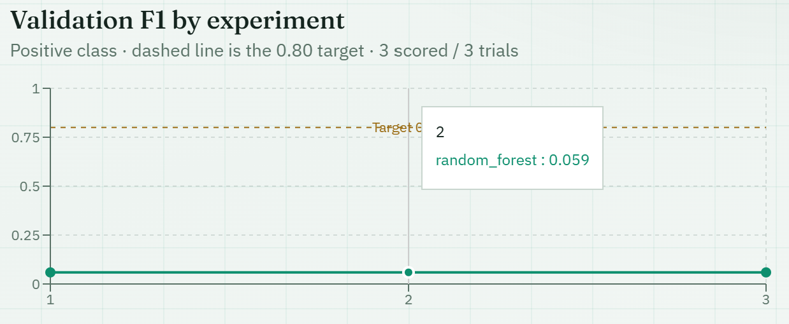

# Fraud pipeline: Airflow ETL → Postgres → agent-based ML loop

This is my weekly assignment, built on the in-class `automl-research-lab` repo (branch `refactor/lab-solution-layout`).

* **Part 1:** a scheduled Airflow DAG ingests three related tables and cleans each one in a parallel TaskGroup. It merges them, loads the result into a Postgres warehouse, then reads it back to train models and draw charts.
* **Part 2:** the in-class LangGraph research loop, adapted. It reads the cleaned table straight from that warehouse, adds three agents, removes one, changes three, and reports metrics suited to rare-event fraud detection.

The original class setup guide is kept in [`docs/CLASS_SETUP.md`](docs/CLASS_SETUP.md).

---

## Key findings (TL;DR)

1. **`fraud_probability` leaks the label.** In this dataset `is_fraud` is a hard threshold on that column: every row with a score above 0.4 is fraud and every row below is not. A model that uses only this column gets ROC-AUC = F1 = 1.0. The pipeline keeps the column in the warehouse, keeps it out of every model, and plots the leak (`leakage_fraud_probability.png`).
2. **Accuracy is misleading here.** Only 3.06 % of transactions are fraud, so predicting "never fraud" already scores **97 % accuracy** with F1 = 0. Both workflows report F1, precision/recall, ROC-AUC and PR-AUC, and compare against baselines.
3. **The honest features contain essentially no fraud signal.** That covers behaviour, customer and merchant attributes, and engineered ratios and mismatches. The best models reach ROC-AUC ≈ 0.53–0.56 and PR-AUC ≈ 0.03–0.04, versus 0.031 for chance. The agent loop detects this and **stops early** (`stop_reason = no_signal`) instead of burning its whole budget. Its best holdout F1 (0.061) is about the same as simply flagging every transaction (0.059).

The data is synthetic (Kaggle *Financial Transaction Intelligence Dataset 2026*, CC BY-NC-SA 4.0). The takeaway is about process: catch leakage, choose the right metric, and compare against a baseline.

---

## Repository map (what I added or changed)

| Path | What |
| --- | --- |
| `lab/airflow/dags/fraud_etl_pipeline.py` | **New** Airflow DAG (scheduled, TaskGroups, Postgres, analysis) |
| `pipeline/fraud_etl.py` | **New** pure-pandas transforms + analysis used by the DAG (testable without Airflow) |
| `lab/langgraph/graph.py` | **Adapted** agent loop (the in-class lab file, now my fraud workflow) |
| `lab/langgraph/fraud_tools.py` | **New** helpers: warehouse loader, leakage scan, baselines, threshold-tuned training |
| `frontend/src/graph/fraudLoopConfig.ts` | **New** live agent-graph layout for the modified workflow |
| `frontend/src/components/LiveSimpleLoopGraph.tsx`, `frontend/src/graph/simpleLoopConfig.ts`, `frontend/src/pages/LabLoopPage.tsx` | Graph component takes a layout config; `/lab-loop` draws the fraud loop |
| `infra/docker-compose.yml` | **New** `warehouse-db` Postgres service + `warehouse_db` Airflow connection + gateway DSN |
| `infra/Dockerfile.airflow`, `advanced/services/gateway/requirements.txt` | + matplotlib (Airflow), + psycopg2 (gateway) |
| `.devcontainer/devcontainer.json` | **New** containerized dev setup (Python 3.12, Node 20, Docker-in-Docker); a copy is kept at `infra/devcontainer.json` |
| `tests/assignment/` | **New** tests for transforms, leakage scan and an end-to-end loop run |
| `reports/fraud_pipeline/latest/` | Analysis report + charts (regenerated by every DAG run) |
| `lab/langgraph/reports/latest_eval.md` | Agent-loop evaluation report (regenerated by every loop run) |

---

## How to run

Prerequisites (same as class): Docker Desktop running, Git Bash on Windows (for `make`), Node 20+. Alternatively, open the repo in VS Code and choose **Reopen in Container**; the devcontainer has Docker-in-Docker, so every command below also works inside it.

```bash
cp .env.example .env            # once (PowerShell: Copy-Item .env.example .env)
```

### Part 1: Airflow pipeline

```bash
make airflow                    # builds images, starts Airflow + Postgres warehouse (1–2 min)
make fraud-dag                  # unpause + trigger fraud_etl_pipeline once
```

Without `make`:

```bash
docker compose -f infra/docker-compose.yml --env-file .env --profile airflow up --build -d
docker compose -f infra/docker-compose.yml --env-file .env --profile airflow exec airflow-scheduler airflow dags unpause fraud_etl_pipeline
docker compose -f infra/docker-compose.yml --env-file .env --profile airflow exec airflow-scheduler airflow dags trigger fraud_etl_pipeline
```

* Airflow UI: <http://localhost:8088> (`admin` / `admin`). Open **fraud_etl_pipeline → Graph**.
* Once it is unpaused, the DAG also runs on its own **every day at 06:00 UTC**.
* Inspect the warehouse: `make warehouse-psql`, then `\dt staging.*`, `\dt analytics.*` and `SELECT model, f1, roc_auc, pr_auc, run_ts FROM analytics.model_metrics;`. Any client also works at `localhost:5433`, user/password/db `warehouse`.
* Outputs: `reports/fraud_pipeline/latest/report.md` plus charts, and `datasets/airflow/fraud_clean.csv` (the hand-off file for Part 2).

### Part 2: agent loop

```bash
make start-windows              # Git Bash (make start-mac on macOS): gateway + UI on :5173
```

Open <http://127.0.0.1:5173/lab-loop>, pick **fraud_clean.csv**, set target **is_fraud** and **max cycles 5**, then click **Run**. The *Warehouse loader* node pulls `analytics.fraud_transactions` from Postgres. If the warehouse is empty or down, it falls back to the selected CSV and says so in its note.

CLI alternative (after `make install` plus `pip install pandas scikit-learn langgraph psycopg2-binary`):

```bash
python lab/langgraph/run_cli.py --dataset datasets/airflow/fraud_clean.csv --target is_fraud --max-cycles 5
```

Setting `OPENROUTER_API_KEY` in `.env` turns on the LLM agents. Without it, every agent uses its deterministic heuristic fallback, so runs are reproducible.

### Tests

```bash
python -m pytest tests/assignment tests/unit/test_lab_loop.py -q     # or: make test-assignment
```

### Stop everything

```bash
make down-windows               # or make down-mac
```

---

## Part 1: pipeline details

### Data sources

Three related tables from `datasets/airflow/` (see [`ATTRIBUTION.md`](datasets/airflow/ATTRIBUTION.md)):

| Table | Rows | Grain | Join key |
| --- | --- | --- | --- |
| `transactions.csv` | 10,000 | one transaction (fact table, label `is_fraud`) | `customer_id`, `merchant_id` |
| `customers.csv` | 1,000 | one customer (dimension) | `customer_id` |
| `merchants.csv` | 200 | one merchant (dimension) | `merchant_id` |

### Transformations

* **customers:** trim strings and de-duplicate on the key. Fill the 336 blank `loan_status` values with an explicit `"No loan"`. Parse `customer_since`. Clip `age` to 18–100 and `credit_score` to 300–900, and clip money columns to be non-negative. Drop `city`/`state`, which contradict `country` in this synthetic file (e.g. UK + Tamil Nadu).
* **merchants:** de-duplicate. Convert Yes/No flags to 0/1. Clip `risk_score` to [0, 1]. Drop `merchant_name` (a unique label with no signal). Prefix columns with `merchant_`.
* **transactions:** de-duplicate, parse timestamps, drop non-positive amounts, convert Yes/No to 0/1. Drop the constant `currency` column (all INR) and the duplicated `merchant_category`. Engineer `log_amount`, `amount_to_avg_30d`, `is_night` and `month`.
* **merge:** transactions ⟕ customers ⟕ merchants, validated `many_to_one` and asserted to keep exactly one row per transaction. Adds `customer_tenure_days`, `ip_country_mismatch` and `merchant_country_mismatch`.
* **quality gate:** each table must have rows, unique keys and no null keys. Otherwise the task fails and retries twice.

### Pipeline structure



Postgres layout (`warehouse-db`): `staging.customers`, `staging.transactions` and `staging.merchants` hold the cleaned tables. `analytics.fraud_transactions` holds the merged table (10,000 rows × 53 columns). `analytics.model_metrics` is append-only, with one row per model per run, so scheduled runs build a history.

### Scheduling and parallel processing

* `schedule="0 6 * * *"` runs daily at 06:00 UTC. `catchup=False` prevents a backfill flood when the DAG is unpaused. `max_active_runs=1` stops two runs from overwriting the same warehouse tables. `dagrun_timeout=30 min` and `retries=2` (10 s apart) handle flaky steps.
* The Airflow stack uses the **LocalExecutor**, so tasks with no dependency on each other run at the same time:
  * the **three dataset TaskGroups** (ingest → clean → check → stage) run in parallel;
  * after the warehouse load, **`train_models`, `eda_charts` and `publish_agent_dataset`** fan out in parallel. All three read from Postgres, not from local files.
  * `merge_datasets` waits on all three staging loads, and therefore on every quality gate. `write_report` joins the fan-out.
* Large data moves between tasks as files in `artifacts/airflow/fraud_runs/<ts>/`. Only paths and small dicts go through XCom.

### Analysis results

These come from a 25 % stratified test split, read from `analytics.fraud_transactions`. The full report is in [`reports/fraud_pipeline/latest/report.md`](reports/fraud_pipeline/latest/report.md).

| Model | Accuracy | Balanced acc. | Precision | Recall | F1 | ROC-AUC | PR-AUC |
| --- | --- | --- | --- | --- | --- | --- | --- |
| Majority-class baseline | 0.970 | 0.500 | 0.000 | 0.000 | 0.000 | 0.500 | 0.030 |
| Logistic regression (balanced) | 0.605 | 0.548 | 0.038 | 0.487 | 0.070 | 0.557 | 0.041 |
| Random forest (balanced) | 0.970 | 0.500 | 0.000 | 0.000 | 0.000 | 0.501 | 0.032 |
| *Leakage check: `fraud_probability` only* | *1.000* | *1.000* | *1.000* | *1.000* | *1.000* | *1.000* | *1.000* |




---

## Part 2: agent workflow modifications

Starting point: the in-class loop `data_scientist → hypothesis_generator → ml_engineer → judge → (memory_writer → context_builder → hypothesis) | holdout_eval`.



| Agent | Change | Why |
| --- | --- | --- |
| `warehouse_loader` | **Added.** Reads `analytics.fraud_transactions` from Postgres (written by the DAG) into a snapshot; falls back to the chosen CSV. | Connects Part 2 to Part 1 through the database, not a hand-copied file. |
| `data_scientist` | **Modified.** Runs a data-driven leakage scan (single-feature ROC-AUC ≥ 0.95, id columns, raw datetimes) next to the LLM/heuristic profile. The scan result is a guardrail that no later agent can undo. | Catches `fraud_probability` from the data itself, not from its column name. |
| `baseline_agent` | **Added.** Scores a majority-class and a "flag everything" baseline on the exact split the models use. | With 3 % positives, 97 % accuracy is free and F1 0.059 is free. Results must be read against these numbers. |
| `ml_engineer` | **Modified.** Class-weighted models; the decision threshold is tuned on validation to maximise F1; reports accuracy, balanced accuracy, precision, recall, F1, ROC-AUC, PR-AUC; leakage drops are always enforced. | A 0.5 threshold almost never fires on rare events, so threshold tuning is needed to get any recall. |
| `judge` | **Modified.** New `stop` action. Judges F1 against the target and PR-AUC lift over prevalence. After 3 cycles with < 1.25× lift it stops ("no learnable signal"). Flags F1 ≥ 0.99 as probable leakage. Guardrail: never accepts below target. | Makes the loop adapt instead of spending its full budget on noise. |
| `context_builder` | **Removed.** Merged into `memory_writer`, which now files the lesson and builds the brief in one step. | One fewer hop with no loss of information. |
| `evaluation_reporter` | **Added.** Writes holdout-vs-baseline metrics and the experiment history to `lab/langgraph/reports/latest_eval.{md,json}`. | The deliverable: a reproducible evaluation artifact. |
| Heuristic `hypothesis_generator` | **Modified** fallback: switches model family before re-tuning the same one. | Weak signal is a feature problem, not a hyperparameter problem. |

The live agent graph (`/lab-loop`) is driven by [`frontend/src/graph/fraudLoopConfig.ts`](frontend/src/graph/fraudLoopConfig.ts). It shows the new nodes and the warehouse store, and drops the context builder.

### Agent-loop evaluation results

These come from a heuristic-mode run (no LLM key, seed 42, max 5 cycles). The full report is [`lab/langgraph/reports/latest_eval.md`](lab/langgraph/reports/latest_eval.md).

| Cycle | Model family | Val F1 (tuned threshold) | Val PR-AUC | Judge |
| --- | --- | --- | --- | --- |
| 1 | logistic_regression | 0.059 | 0.029 | revise |
| 2 | random_forest | 0.061 | 0.027 | revise |
| 3 | hist_gradient_boosting | 0.061 | 0.027 | **stop**: no learnable signal |

| Sealed holdout | Majority baseline | Flag-everything baseline | Best agent model (random forest) |
| --- | --- | --- | --- |
| Accuracy | 0.970 | 0.030 | 0.146 |
| F1 | 0.000 | 0.059 | 0.061 |
| Recall | 0.000 | 1.000 | 0.918 |
| ROC-AUC | 0.500 | 0.500 | 0.561 |
| PR-AUC | 0.030 | 0.030 | 0.037 |

The loop stopped after 3 of 5 cycles. It found and dropped the leaky score, and showed that the remaining features only barely beat the trivial baselines. That matches the Airflow analysis in Part 1.

---

## Screenshots

These are saved in `docs/images/assignment/`:

| Required screenshot | File |
| --- | --- |
| Successful DAG run (Airflow grid view, all green) | `airflow-dag-run.png` |
| DAG graph view (TaskGroups expanded) | `airflow-dag-graph.png` |
| Live agent graph after a run (`/lab-loop`) | `agent-graph.png` |
| Model evaluation results (agent-loop panels + `latest_eval.md` / `analytics.model_metrics`) | `agent-eval.png`, `warehouse-metrics.png` |





