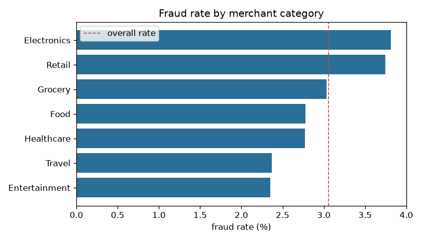
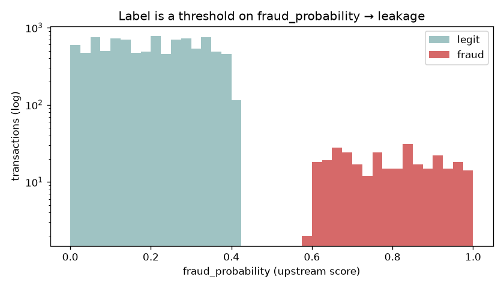
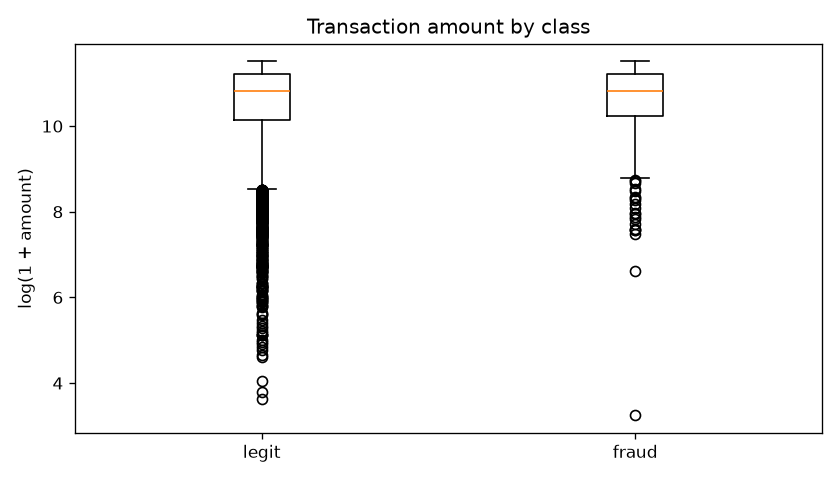
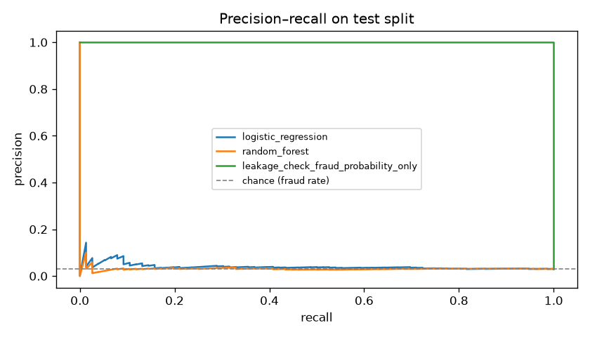
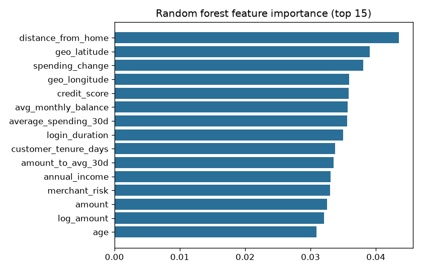

# Fraud pipeline report — run `manual__2026-11-11T23:32:59+00:00`

## Data quality (after cleaning)

| table | rows | columns | duplicate keys | null cells |
| --- | --- | --- | --- | --- |
| customers | 1000 | 13 | 0 | 0 |
| transactions | 10000 | 31 | 0 | 0 |
| merchants | 200 | 8 | 0 | 0 |

Merged table: 10000 rows, 46 candidate features, fraud rate 3.06%.

## Models (25% stratified test split)

| model | accuracy | balanced acc | precision | recall | F1 | ROC-AUC | PR-AUC |
| --- | --- | --- | --- | --- | --- | --- | --- |
| majority_class_baseline | 0.970 | 0.500 | 0.000 | 0.000 | 0.000 | 0.500 | 0.030 |
| logistic_regression | 0.605 | 0.548 | 0.038 | 0.487 | 0.070 | 0.557 | 0.041 |
| random_forest | 0.970 | 0.500 | 0.000 | 0.000 | 0.000 | 0.501 | 0.032 |
| leakage_check_fraud_probability_only | 1.000 | 1.000 | 1.000 | 1.000 | 1.000 | 1.000 | 1.000 |

## Charts

Agent dataset published: `/repo/datasets/airflow/fraud_clean.csv` (10000 rows)
